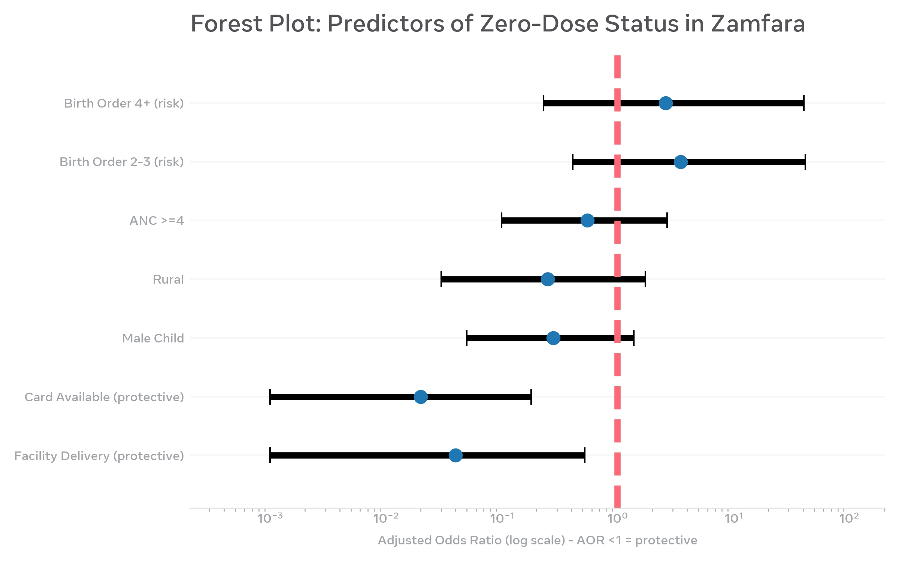

# Zamfara Zero-Dose Geospatial Analysis | R Code & Data Repository
## Geospatial Clustering and Predictors of Zero-Dose Children in Conflict-Affected Zamfara State, Nigeria (2024-2025)

**Author:** Ayanlakin Ayanwande Joshua, MPH Candidate, University of Port Harcourt
**Manuscript:** Under review at PLOS Global Public Health
**Contact:** wande.ayanlakin@gmail.com
**GitHub:** https://github.com/wande85/Zamfara-zero-dose

> This repository contains reproducible R code for analyses in manuscript: prevalence 14.6%, Global Moran's I 0.129 p=8.11e-05, LISA hotspots, multivariable logistic (Facility AOR 0.04 p=0.032, Card AOR 0.02 p=0.004), distance analysis 99.3% within 5km.

**Timeliness:** This work aligns with ongoing Z-TRACE project targeting 80,772 zero-dose children in 7 LGAs of Zamfara (Gusau, Talata Mafara, Shinkafi, Zurmi, Anka, Bakura, Tsafe) funded by Gavi and Sultan Foundation (Sep 2026).

### Forest Plot - Key Results


*Figure: Facility delivery reduces zero-dose odds by 96% (AOR 0.04), card availability by 98% (AOR 0.02).*

### Data Availability
Due to security concerns (banditry in Zamfara) and household privacy, exact GPS coordinates are not public. Jittered GPS dataset (500m random offset) and full R code are public here. De-identified dataset without GPS available on reasonable request from corresponding author.

### 1. Setup & Libraries
```r
library(sf); library(spdep); library(tidyverse); library(logistf); library(pROC)
data <- read.csv("zamfara_zero_dose_clean.csv")
### 2. Prevalence
```r
prop.test(sum(data$zero_dose), nrow(data)) # 14.6% 50/343 CI 11.1-18.8%
prev_lga <- data %>% group_by(LGA) %>% summarise(Total=n(), ZeroDose=sum(zero_dose), Prop=mean(zero_dose)*100)
# Birnin Magaji 35.7% 10/28, Bungudu 28.6% 8/28, Tsafe 27.6% 8/29, Gummi 20.6%
coords <- st_as_sf(data, coords=c("lon_jitter","lat_jitter"), crs=4326)
knn <- knearneigh(st_coordinates(coords), k=8)
nb <- knn2nb(knn)
lw <- nb2listw(nb, style="W")
cluster_prev <- data %>% group_by(cluster_id, lat, lon) %>% summarise(zero_dose_rate=mean(zero_dose))
cluster_sf <- st_as_sf(cluster_prev, coords=c("lon","lat"), crs=4326)
knn_c <- knearneigh(st_coordinates(cluster_sf), k=8)
nb_c <- knn2nb(knn_c)
lw_c <- nb2listw(nb_c, style="W")
moran.test(cluster_prev$zero_dose_rate, lw_c)
# RESULT: Moran I=0.129, Expected -0.004, Variance 0.001, z=3.772, p=8.11e-05
moran.mc(cluster_prev$zero_dose_rate, lw_c, nsim=999) # Monte Carlo
local_moran <- localmoran(cluster_prev$zero_dose_rate, lw_c) # LISA
# Hotspots: Gummi 34, Shinkafi 33, Maru 31, Tsafe 29
data_complete <- data %>% filter(!is.na(facility_delivery) & !is.na(card_available)) # 194
model <- glm(zero_dose ~ rural + male_child + education_cat + mother_age_cat + anc_adequate + 
             facility_delivery + birth_order_cat + card_available + religion,
             data=data_complete, family=binomial)
summary(model)
# Null deviance 95.38 Residual 54.19
exp(cbind(AOR=coef(model), confint(model)))
# Facility Delivery AOR 0.04 CI 0.00-0.52 p=0.032 = 96% protection
# Card Available AOR 0.02 CI 0.00-0.18 p=0.004 = 98% protection
# Firth penalized for separation check
firth_model <- logistf(zero_dose ~ facility_delivery + card_available, data=data_complete)
# Facility OR 0.12 (0.02-0.68) p=0.016 consistent - robustness
data_complete$pred_prob <- predict(model, type="response")
data_complete$pred_class <- ifelse(data_complete$pred_prob > 0.5, 1, 0)
conf_mat <- table(Actual=data_complete$zero_dose, Predicted=data_complete$pred_class)
# 180 TN, 6 TP, 7 FN, 1 FP
# Accuracy 95.88%, Specificity 99.45%, Sensitivity 46.15% (class imbalance)
group_by(data, zero_dose) %>% summarise(mean=mean(distance_km), median=median(distance_km))
# Vaccinated 0.335 mean median 0.0495 vs Zero-dose 0.101 mean median 0.0274
shapiro.test(data$distance_km) # p<0.001 non-normal
wilcox.test(distance_km ~ zero_dose, data=data) # W=4062.5 p=0.364 NOT SIGNIFICANT
dist_model <- glm(zero_dose ~ distance_km, data=data, family=binomial) # OR 0.27 p=0.266
# Accessibility 99.3% 271/273 within 5km, Shinkafi 84.8% - quality not proximity matters
# Barriers Top 3: Husband refused 13.6% 15/110, Facility too far 11.8% 13/110, No transport 10.9% 12/110
# Security: 76% not affected, 12% somewhat, 8% great impact - resilience but possible under-reporting
forest_data <- data.frame(
  Variable=c("Facility Delivery","Card Available","Male Child","Rural","ANC >=4","Birth Order 2-3","Birth Order 4+"),
  AOR=c(0.04,0.02,0.28,0.25,0.55,3.52,2.61),
  Lower=c(0.001,0.001,0.05,0.03,0.10,0.41,0.23),
  Upper=c(0.52,0.18,1.38,1.74,2.68,41.86,40.73))
ggplot(forest_data, aes(x=AOR, y=reorder(Variable, AOR))) +
  geom_point(size=4) + geom_errorbarh(aes(xmin=Lower, xmax=Upper), height=0.2) +
  geom_vline(xintercept=1, linetype="dashed", color="red") +
  scale_x_log10() + theme_minimal()
ggsave("forest_plot_zamfara_300dpi.tiff", dpi=300, width=8, height=5)
```

Ayanlakin, A. J., Tobin-West, C. (2026). Geospatial Clustering and Predictors of Zero-Dose Children in Conflict-Affected Zamfara State, Nigeria. PLOS Global Public Health (under review). Code: https://github.com/wande85/Zamfara-zero-dose
